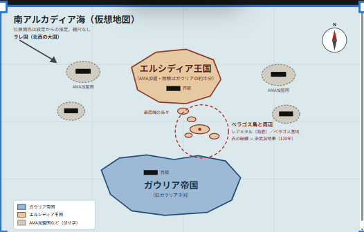

##1024日のTODO
このtodoを一個ずつやっていてください。またもし一気に直すのが難しいなら一つ一つ行ってください。（精度を気にするので、もし質問があれば勝手に推測せずに質問してください。また精度よくやるためにもし一気にまとめてやるとでうまくいかない可能性があるならばちゃんと言ってください）
博物館の音声とR35の音声以外は似ている内容の音声で各言語２種類ずつ作ってください。

## todo r35の変更について
今まで使っていたｒ３５がｓｆ過ぎたのでomega fighterGに変更したいです。ただしぇだーがピンクになっているので修正してほしいです。また椅子は最低限自分が修正するので、すべて現在使っているｒ３５はすべてこのomega fightergに変更する予定です。なのでとりあえず1機だけ変えてみてください。そしてプログラムをつけさせてください。また椅子もテキトーに配置しておいてください。自分が修正しそのあと指示を出すのでその時にそれらを複製し、すべてのｒ３５を置き換えてください

## to do（ガソリン）
速度が速いほどガソリンをは行く消費してほしいです。またガソリンがどれくらい残っているかをパネルで表示しておいてほしい
そして、リスポーンの近くの潜水艦の近くを通る（今はHPや玉が回復している範囲で）ガソリンも回復してほしいです。ただ満タンの時にずっとフルスロットルだとすると５分持つぐらいのガソリンにしてください。またできれば、そこもリアルにしたいので、数が気的な式などを立ててやってほしいです
### TODO（遊覧モードで付けたい機能。今は選べるだけで、動きは普通モードと同じ）
//
//  1. 敵ドローンは撃ってこない
//     → EnemyDrone 側で gameMode._IsSightseeing() の時は fire / ミサイル発射を止める
//       （追いかけずに、普通に巡回するだけにしてもよい）
//
//  2. 敵機が「ようこそ我らの国へ」のような歓迎メッセージを出して編隊飛行する.　（最高５き）
//銃を撃つ分には何も起きないが、もし何かしら破壊してしまったら、ポイントはｘ３で追撃付きのミサイルを持った飛行機及び戦艦に持たユーザー全員を攻撃してください。そして下の文にも関係してくるが、もしその前に基地に通ってから、その状態になり基地の上を通ると「非常に残念である」とアイン中将が言ってほしいです。これは戦闘はパネルには書かないでください。隠し要素です。このゲームの説明には書く予定ですが（におわせ程度で書く予定です）。
//、下のTODOにも関係してくるが、既知の方向に向かっていて、ある程度近づいたとき、「こちら海軍、アイン・エメラルド中将である。。ここはわれわれAMA所属エルシディア国の南アルカディア海に浮かぶぺラゴス基地である。良い旅を、もし休息が必要なら自由に急速に使用せよ」と言ってほしいです。そしてもちろん着陸したらHPやガソリンが回復してほしいです。また空母に近づいたら、「こちらAMA連合艦隊旗艦ユリシーズの艦長グアン・ローエングラムである。貴官の良い旅を願っている。もし休息が必要なら、この空母で休むことを許可する。またメンテナンスもしてやることが可能である」と言ってほしいです。もちろん絵はアインとは変えてください。
//それに伴って、フレアを実装したいです。
またボタンの色も青に変更したいです。
またハードモードに追加で、対空が追加でつくというのもともとですが、もしプレイヤーがミサイルを打った場合、ミサイルに対して対空砲火をするようにし、プレイヤーをいったん狙うのをやめるようにしてください。そしてもしみさいるが対空砲火で失敗したとき、それの時専用の音声をR35では流してください。

### ToDO （基地に近づいたとき、今までのワーニングとは違ったワーニングがあってほしい
イメージとしては、「こちら海軍、アイン・エメラルド中将である。ここはわれわれAMA所属エルシディア国の領海及び飛行禁止エリアである。貴官は今、我らの領海内に侵犯している。直ちに離脱願う。２度目の警告はない。」と言って、そのあと、１０秒以内に離脱しなかったら、打ってきてほしい。離脱したら「感謝する」と言ってほしい。　もちろん、今まで使っている男の人の声とは変えてほしい。またその前に、戦艦からの前からあるワーニングされていた場合はワーニングする必要ないです。そして、逆にこのアインのワーニングを無視した場合、前からあるワーニングをする必要はないです。つまりどちらかでいいです。
また基地から戦闘機が離陸してこっちに向かってきてほしいです。個の戦闘機はある一定の距離基地から離れたら基地に帰って着陸するようにしてください。ただ帰還の途中、プレイヤーを見つけたら、警告がされていなかった場合はすでにある警告を行い、警告をすでにされていたら、攻撃をしていってください。ただある一定の距離追い払ったら、基地に帰還して着陸してください。
また基地は対空砲火ができるように今おいてある大砲を改造してください。つまりこの大砲は大砲を打つのではなく対空砲火を行うようにしてください。この対空砲火はプラスでプレイヤーがもしミサイルを打ったらプレイヤーではなくミサイルを狙うようにして対空防御をするようにしてください。そしてこれは遊覧モード以外で有効にしてください。
また基地の建物は全部破壊できるようにしてください。また消えるのではなく壊れてがれきになって燃え続けるという感じになってほしいです。またこれは修復されず破壊されたままにしてください。そして基地の建物をすべて破壊したら１００点を破壊したプレイヤーに与えてください。
## todo 爆撃
今は銃と２種類のミサイルがプレイヤーの攻撃手段ですが、追加で爆撃、つまりボムを落とせるようにしたいです。またもしVRでボタンの配置に余裕があれば、魚雷もついかして、魚雷もR35は打てるようにしたいです。魚雷はボムのように落ちて、その後今の船が動いているときに出ているような波の跡を出しながら、ある一定の進んでほしいです。またもし基地に魚雷を落とした場合や島に落ちた場合、ボムと同じ挙動してください。魚雷が水中で島や戦艦にあった場合爆発と水柱をたたせてください。そして魚雷のほうがミサイルよりダメージを大きくしてください。ボムも海上に落ちた時大きな水柱をたたせてください。

## TODO （ゲームが始まった時にいるmain roomについて）
この部屋を改造して、潜水艦の艦橋みたいにしたいです。またテレポートもドアをクリックにしたいです。具体的には銀英伝の同盟軍の戦艦みたいな見た目がいいです.
またmain roomでの今の装飾は自由に変更及び削除を行っていいです

## todo 敵の戦艦について
今だと半分ぐらいバグで表示されないまま動いているときがあるので、それは何か知りたい（もしゲームを重くしないためのものなら、別に直す必要ない）

## todo　ユーザーが使う潜水艦をもっと基地から離れたときところから始めたい
これは、のちのちやるから、claudeは何も今はする必要ないです。単純に自分にリマインドしてください。

## todo 戦艦などの大きさの調節
いろいろと建物や飛行機、船の大きさをいじったのですが、もし変な大きさのやつがあったら、直してほしいです

## todo 空母に近づいたらのワーニング
基地に近づいたら、ワーニングなるように、空母に近づいたら、「こちらはＡＭＡ連合艦隊旗艦ユシリーズ艦長グアン・ローエングラムである。不明飛行機に警告する。おとなしく投稿しろ。」と言ってほしいです。これはほかのワーニングがあったとしてもなってほしいです。
またそのワーニングにプラスで空母から戦闘機を発信させてほしいです。その戦闘機は基地の戦闘機と同じである一定の範囲でしか活動できなくて、その範囲にプレイヤーが誰もいなかったら、着艦してください。そして、この戦闘機はほかの戦闘機とは違うように日本のF2Aのように水色みたいな青色にしてください。そして、この戦闘機は今までの戦闘機とは違って追跡付きのミサイルを使用してください。また書くのをわすれていましたが、R35に追跡付きミサイルの場合は、追跡付きミサイルが何時から接近と警告してください。

## todo 日本語の音声も用意する
m最初にこのゲームワールドに入った時にUIが目の前に出てきて 日本語と英語の選択ができるようにしたい、日本語が選択された場合、音声及び」ワールドの内容をを全部日本語で実施したいです。また英語の音声もなのですが、今は戦闘機のことをドローンと言っているので戦闘機と言ってください

## todo R３5のバグ
ｒ３５を出した瞬間にもう一度押すとｒ３５が2機一気に出るというバグあるので、ｒ３５はカタパルト周辺に絶対一基しか出ないようにしてください。ただほかのプレイヤーが空中や海上で回復しているときは出てほしいので、範囲でやる場合は注意してください。colliderで触れているかいないかと距離のハイブリットがいいと思います。

## todo r35の銃のバグ
＋のところに銃やミサイルが飛んで行っていないという苦情をいただきました。ちゃんと狙ったところに行くようにしてください

## todo 宇宙エレベーター
宇宙エレベーターの機能は消すので、残っているものはすべて削除してください

## todo 戦艦の出現範囲
戦艦は絶対海の上に出るようにしてください。また広範囲なので、全プレイヤーからある一定の距離離れている状態が１０秒以上続いたとき、一番近くのプレイヤーがぎりみれないところらへんまで移動させてください。また基本的に艦隊以外は一人のプレイヤーに対して5隻まで近くに出現するようにしてください（一人の時たくさんの戦艦が出すぎるのを防ぐため）

## todo その他
自分が結構改造したので、不具合があるかもしれない箇所がたくさんあるので、claudeではなく自分がやったところを確認してください

## to do 貨物船
貨物船はテキトーな場所にランダムで出現してください。また貨物船は1隻の戦艦と艦隊を組んで行動してください。つまり、貨物船と1隻の戦艦は一緒に行動してください。ただ貨物船の近くの戦艦が撃沈した場合、貨物船が撃破されるまではリスポーンしないでください。逆の貨物船が撃破されて、歓待している戦艦が撃墜されなかった場合、貨物船は2分後にリスポーンしてください。また貨物船は1点にして点数に数えてください。また貨物船を撃破した場合、プレイヤーのミサイルや銃に球は補充するようにしてください

## todo main room に飛行機の操縦方法とこのゲームのモードの説明をするパネルを置いてください
パソコンもＶＲもどちらもです 

## todo よくあるＶＲＣの飛行機のワールドとおなじ操縦方法にする
友達に操縦方法が変で動かし肉と言われたので、よくあるＶＲＣの飛行機のワールドとおなじ操縦方法にしてください。ただ、このゲームオリジナルの機能があったら、それは消さずにそのまま残してください。それのせいでコンフリクトが起きたら、オリジナルの機能のボタンを変更してください

## todo 敵の戦闘機
なんか敵の戦闘機とすれ違う時などに、敵の戦闘機がめっちゃ遅く見えるのですが、これは早くする方法はありますか。あったらそれを実行する前に見せてください。

## todo日本語を英語に
なんこかのインターラクトはにほんごでuseなどがでてえいごでは出ないから出るようにして。これは英語が選択されているかにほんが選択されているかによって分かれます

## todoまだ未定だが、セルリアにあるラレの基地について
セルリアにあるラレの基地から、大規模な艦隊がきて、それと戦うというのも増やしたいと考えている。具体的には遊覧モードである程度の時間がたつとこのもーどがおきてほしい。でも、とりあえずこれはのちのちせいさくするので、リマインドしてほしいだけで制作しないでください。

## todo 博物館
この部屋を裏話部屋にしたい。下にも書いたけど、この地域の歴史をせっかく考えたから書きたい。そしてなんでプレイヤーは戦うのか、この２つのモードの違いは何なのかというね（歴史の分岐点）。この部屋はmain room にドアを置いてそこからいけるようにしたいです。
とりあえず、今は年表とそれらの事情説明を置いておいてほしい。日本語と英語の２枚。
あと、音声でこれらの説明を聞けるボタンを英語用と日本語用の２個用意しといて。（これは最初に言語モードの選択関係なく２個あってほしいです）
この説明は長くなってもいいからちゃんと全部説明しておいてほしいです。
またその音声の説明は博物館にあるみたいに説明していってください。
音声は男の人の声でお願いします。
なんなら、博物館みたいなものなので、壁にここでの歴史について展示されているイメージです。
まあ、博物館みたいな感じです。

## todo ゲームでsoliderとい人型がたくさん置かれているのだけど、それらは重くならないようにする
重くならないようにもともとのポリゴンなどは最小限にしています。でもそれ以外に軽くできるなら軽くしてください。
また、兵士以外でもゲーム全体で軽くできそうなところがあったら軽くできるようにしてください。
とくに基地が重いのでできれば軽くしたいです。また兵士が今はTポーズしているのでそれも修正しておいてほしいです。

## todo 島のテクスチャが違う
基地だけ自分で位置から作ったというのがあって基地がある島だけテクスチャが違うので、すべて同じように合わせてください。こではできればでいいです。またterrainの島のテクスチャもいろいろとツールでいじっていたら変になってしまったので、もともとあった島に合わせても、terrorianに合わせるでもどっちでもいいです。ただ後で自分でterrainに滑走路を引く（もしできるならこれもやってほしいですが、変になりそうなので、このtodoがすべて終わってテストをして自分が確認してからやれるならやってください。滑走路はアストラルと基地の２つにそれぞれ１こずつあり、飛行機が置いてあるところからマイナスのｘ軸方向に延びています。ただ飛行機が置いてあるところはエプロンなので、そこからｚ軸の正の方向にすこし伸ばしてエプロンを作ってからｘ軸のマイナス方向に滑走路を引く感じです）また、できればリアルにしたいです。また人がいる島は見てわかるかもなのですが７個の島から構成されているのですが、それぞれを別々のterrorianに変更することは可能ですか。可能ならお願いします。

## todo またmain roomにゲーム何の時間を変えられるスイッチを付ける
そのスイッチをやることで夜や昼に帰ることができるようにしたい。夜でも島は光らせる必要はないです。基地と人が住んでいる島だけ光らせたいので２つの島だけ光ってほしいです。人がいる島は島が光っているというよりは建物と置いてある古い船が光っていてほしいです。基地にしても建物が光っているのと滑走路が見えるように光っていてほしいです。また戦艦は光る必要ないです。ただ探照灯（サーチライト）：敵を照らし出す際や目標確認に使うことがあるそうなので、ミサイルを打つときなどは光らせてください。また飛行機は緑と赤のランプが光っていてほしいです。また夜はスカイボックスを変えたいのでinsepctorに入れられる欄を２つ昼と夜で用意してください

## todo ２人目の修正
２人目の席に座っている人にもレーダーでどこから敵が来ているかを見れるように一人目が座っている席の後ろにレーダーを張り付けてください。また後ろの席に人も警告の音など（ストールとか）が聞こえるようにしてください

## todo 身長について
このゲームは身長が小さいキャラだと見れないため、慎重を１．６０ｍに強制でするということをしたいです。（もし、できればシミュレーションのキャラの伸長にしたいですが）
## todo ラジオについて
ラジオで声をよく拾いすぎてしまっているため、ラジオで会話するとき今より声を小さくしてほしいです。

## todo 人がいる島
人がいる島とアストラル島にある建物は破壊的できるようにしてください。またここをワーニングがある前に破壊したとしても、戦艦で見つかった時などにワーニングは後でするようにしてください。また難しいと思うのでできたらでいいのですが、この人がいる島は１つのterrainで４つの島を作っています。その島の間を戦艦が通り抜けることは可能ですか？
またアストラル島においては、ぺラゴス諸島の中で一番栄えている島です。

## 警戒機について
基地にある警戒機は銃やミサイルに会ったら爆発するようにしてください。またこれらは飛ばないでください。その代わり、これらとおなじものを３基ほどどこかをワールド内でテキトーに飛んでいてください。この警戒機は攻撃を一切してこないでください。（もちろんこちらの攻撃はダメージ与えることできますが）、そのかわり、ずっと２機の戦闘機と編隊飛行を普段はしていてください。またこの警戒機はほかの戦闘機より探索範囲が２倍程度広くプレイヤーを見つけるようにしてください。そしてプレイヤーを見つけたら、ハードモードではすべての戦闘機に連絡をし、ノーマルでは編隊飛行している２機の戦闘機にのみ連絡をし、戦闘機に攻撃させてください。

## アストラル島について
アストラル島には空港があるが、住民は実はガウリア帝国のほうを支持している人が多いため、近づいたときに「こちらパラゴス諸島、アストラル空港管制室である。貴官の航空機はガウリア帝国のものだと推測する。我らはガウリア帝国による統治を望むため休息をしたければ着陸することを許可する。ただ、我らは形式上エルシディア王国の領土であるため、護衛をすることはできない。ご了承いただきたい。」と音声が流れてほしい。そして、この空港に着陸した場合、玉・ミサイルの回復と機体自体のHP,ガソリンを回復することができる。また、エルシディアの戦闘機に攻撃されているときに着陸しようとしている（スピードを落としていて、フラップを付けている時は特別な会話として、まずエルシディアの戦闘機のパイロットの声でアストラル島の管制官と言い合っている内容の会話を聞きたい。この会話は７種類くらい用意してください。内容は、捕まえておいてとかパイロットが言って、管制官がそれはむりだ。われらはガウリア帝国に味方するというとか。ほかには管制官がこちらで捕まえておくから、パイロットは離脱願うと言い、パイロットが了解といい、その後、管制官がそんなわけねーだろ、馬鹿がと小声でいうとか。管制官がこちらガウリア帝国領アストラル空港管制室である。貴官の航空機はこの領空を飛ぶことを許可されていない。今すぐ離脱願う。と言いパイロットがはあ？何言っているんだといってそのあと言い争いをちょっとしてから、パイロットが離脱するとか。
またアストラル空港に着陸するような行動をプレイヤーがとったとき、戦闘機は攻撃をやめて音声を流し、その後離脱して、離れていってください。

もし戦闘機に追われているいない場合に着陸するときは、「こちりパラゴス諸島、アストラル空港管制室である。貴官の着陸を許可する」と流れてください

また遊覧モードでは、ようこそアストラル空港へ。貴官を歓迎するといってください。
また、できるならやってほしいこととして、今の島は建物がテキトーに並んでいるだけなのですが、よりリアルな町っぽくする方法はありますか。

## 操縦席にレバーを付けてください。
まず両足の間に飛行機のwasdでうごかせる（またwasdが押されたときにそれも連動する）レバーを付けてください。そして、左手側に加速するためにあるレバーを付けてください（電車の操縦とかでよくある感じの回すではなく、倒すタイプのレバーです）またできればｖｒではそれを触れることもできてそれで動かすことができるようにしてください。（これはできればでいいのでこのtodoリストのほかのtodoがすべて終わってから実施してください）。

## 最初にコクピットに乗り込んだときに出るメッセージ
最初に乗り込んだときに出るメッセージがあると思うのですが、それをpc版ならshift、ｖｒならそれに対応するボタンを長押ししてくださいと出るようにしてください

## 島の近くの海は浅くしてほしい
具体的に言うと島に近ければ近いほど青ではなく水色っぽくした

## todo ゲームを軽くする
このげーむはだんだん重くなってきているため、軽くしたいです。

## 博物館に戦死者の弔い箱みたいなの作りたい
具体的に言うとおりづるをプレイヤーが箱の中に入れることができるようにして、その箱は外部のapiとかでつなげといて今までなんにんくらいが箱に入れてきたか見れるようにしたい
内容はガウリア帝国・AMAを含むすべてのアルカディア海に住んでいた住人の戦死者のためにと書いてほしい。もしこれがｖｒｃの規約に違反するならいらないです

## ここから書くのはこのゲームの舞台となる場所の歴史（せってい）

もしこの歴史をもとにワーニングが変だったら、変えて
あと、のちのちこの歴史についての紹介する部屋をmain roomからいけるようにするのと、動画でこんな経緯でこのゲームでプレイヤーがR35にのって戦闘するのや何が任務なのかについて説明する動画みたいなのを作りたい。【博物館】

アルカディアの歴史：

アルカディア歴０年（18xx年）：アルカディア帝国が北アルカディア海の■■島で誕生し、北アルカディア海を完全制圧
アルカディア歴５年：アルカディア帝国が東アルカディア海にある島々を制服
アルカディア歴１７年：アルカディア帝国が西アルカディア海にある島々を征服
アルカディア歴２０年：アルカディア帝国が南アルカディア海にある島々を制服
同年：アルカディア憲法を発令し、アルカディア帝国は３７の王国からなり、３７の王国の上にアルカディア帝国皇帝がいると明記される。
アルカディア歴７５年：アルカディア帝国の皇帝一家が全員暗殺され、国の方針を巡って内乱が勃発
アルカディア歴７６年：エルシディア、ラレ、■■の３つの王国が手を組み、帝国領内すべての内乱を鎮める。（この内乱の最中、ガウリア王国の領土であったぺラゴス島及びその周辺の島々はエルシディアの領土になる、この内乱中にガウリアはオーラリアを攻めて、オーラリアの■■島の住民を虐殺している（■■虐殺）。しかし、実際はガウリア国王が命令して虐殺したのではなく、現場の兵士が勝手にしただけだった。これに加担した兵士はガウリアからオーラリアに送られ死刑になった。しかし、この虐殺が原因でオーラリアはガウリアが嫌いであり、現代まで脅威と感じつづけている）
同年：３国による独裁政治が始まる（この３国のことをアルカディア３大国とよばれた）（独裁政治を行うためにエルシディア王国は南アルカディア海及び北アルカディア海の一部の国々の王の妻子をエルシディアの首都である■■で済むことという命令を実施。）
アルカディア歴７７年：エルシディアがぺラゴス島に基地を制作。（エルシディア王国の最南端の島であり監視のため）
アルカディア歴９１年：この３国の関係が悪化し、紛争が始まる
同年：これらの紛争が、アルカディア大海戦争と呼ばれる大きなものになっていき、アルカディア海全域で紛争が勃発大体どの国をこれらの３つの国からどの国の味方になるかを決め、戦争に参加）
アルカディア歴９７年：アルカディア大海戦争の終結およびラレが領土を再配分した（アルカディア３大国の一つであるラレが勝利し、　ほかの大国であるエルシディアと■■は大幅に領地を失う。でも、ぺラゴス諸島の島々はエルシディア領のままであった。ただガウリア王国にはほかの領地を与えた。）
同年；ラレ国によるアルカディア海全域の統治が始まる。（ラレ王が皇帝代行を名乗った）
アルカディア歴１１２年：ラレ国において跡継ぎ争いがおこる
アルカディア歴１１３年：ラレ国の仙台の■■の弟、■■がラレ国の王となる。
同年：跡継ぎ争いによりラレ国及びラレ国のことをよく思っていた国々（昔（アルカディア歴７６年）からのラレ国の属国たち）の力が弱まり、アルカディア帝国離れが起き始める（アルカディア帝国から離れ、独立する国が多発する）（アルカディア歴１２０年までの間に、３７王国の中の２０この王国が独立した）
同年：ガウリア王国がアルカディア帝国から独立し、ガウリア帝国と名乗る。
アルカディア歴１１４年：エルシディアがアルカディア帝国から独立し、また近くの他４か国（オーラリア、etc）と同盟し、ＡＭＡを発足する。
アルカディア歴１１６年：ぺラゴス諸島の海底にレアメタルがあることが発見される。
同年：ガウリア帝国がもともと我らの領地であったと主張（実際、アルカディア歴７６年の紛争の時にエルシディアによってとられているため、事実ではある）
同年：エルシディアがＡＭＡと共にぺラゴス島周辺で演習を始める
アルカディア歴１２０年：エルシディアの首都である■■でぺラゴス島周辺を非武装地帯にする内容に関する条約をガウリア帝国とエルシディア王国が締結
同年：同年の条約により、ぺラゴス基地は廃基地となる。
アルカディア歴１２６年；ラレ国が独立した■■国に侵略を開始する。（まだ決着はついていない）
アルカディア歴１３５年：ガウリア帝国が最新鋭の戦闘機であるＲ３５を制作。
アルカディア歴１３６年：アルカディア海全域の航空の軍事大会でＲ３５の性能がほかの戦闘機を圧倒することを示す。
同年；ぺラゴス事件が勃発する（ぺラゴス事件とは、アルカディア歴１１２年に同地域の非武装に関する条約を結んだにもかかわらず、エルシディアがその条約を破棄することを一方的に行ったのである。具体的にはぺラゴス基地の再稼働及びAMA連合艦隊による演習の実施の決定である。それにより、同地域における緊張が高まる。）

ここからがゲームの内容で
遊覧モード：ぺラゴス事件後に外交交渉が行われ、ラレへの警戒という共通の利益が一致した。ガウリア帝国はエルシディアと合同演習で信頼を築くために、もしセルリアの基地からラレ国が進行してきたときのために、その演習に自国もさんかしたいと持ち掛け、演習を行うことになった。その演習の一環として、Ｒ３５とイ４０２をぺラゴス島周辺に派遣した
それ以外のモード：ガウリア帝国はぺラゴス事件で、連合艦隊との演習を同地域で行うという情報が入ったのでイ４０２とＲ３５を派遣し偵察を行わせた。しかし、偵察中、気づかれ戦争になってしまい、南アルカディア海大戦になってしまう。

メモ：
・アルカディア海は北アルカディア海、南アルカディア海、西アルカディア海、東アルカディア海と４つある。
・■を使っているところは、わざと伏せている。絶対優勢明の時はぐちゃぐちゃに塗りつぶされて感じとかで読めないようにしたい。
・ガウリア王国がガウリア帝国と名乗ったのは、もう２度他国から植民地のような扱いをうけないぞという決意から、当時の王が命名した。しかし、実際はガウリア王国と何も変わらず、名前のみ変わったのである。
・アルカディア歴１１４年にもともと大国であったはずのエルシディアがＡＭＡに加入した理由はアルカディア大海戦争で領土を大幅に失い、小国になっていたからである。どれくらい小国かというとガウリア帝国の半分の領土しか持たないである・
・このＡＭＡは南アルカディア海の小国５か国で結成された同盟であり、どれか１か国でも攻められたらほかの４か国で守ろうという同盟である。小国とはいっても、南アルカディア海の中心にある国々（だからアルカディア歴７６年にエルシディアがほかの国々を圧倒したのはこれが理由の一つである。またほかの同盟国のひとつにオーラリアがあり、■■虐殺の影響でガウリアを脅威におもっているため同盟に参加した）で結成されているため、経済力がとても強く南アルカディア海の中で一番強い組織になっている。
・アルカディア歴１２０年にこの非武装に関する条約を結んだ理由は、エルシディア王国内部でも、もともとガウリアのものなのだから返したほうがいいのではないかという世論が出てきていたからである。（もともとレアメタルはぺラゴス島周辺以外でも領海内でとれるため、戦争を恐れた市民が多数いたのである）
・アルカディア歴１３６年にぺラゴス事件が起きたのは、エルシディア王国が最新鋭の戦闘機であるＲ３５を本気で怖がったからである。Ｒ３５の性能はエルシディア王国の１個中隊に匹敵するにも凌駕するともいわれたからである。またなぜガウリア帝国がわざわざ名前をガウリア王国からガウリア帝国と帝国に名前を変えた理由を信じていなかったというのも理由の一つである（わざわざ帝国としたため、アルカディア帝国のようにアルカディア海全域を統治する野望があるとエルシディアは思っていたのである）
・ガウリア側は１３６年の大会で「これほどの兵器を見せつければ、AMAもペラゴス島周辺で軽率な挑発をしてこないだろう（抑止効果）し、ラレ国にたいしても抑止力になるだろう」と思って公開したものの、逆にエルシディア側のパニックを誘発してパニック的な条約破棄（ペラゴス事件）を引き起こしてしまった

・なぜ現在ではアストラル島が一番栄えているのに、ぺラゴス諸島と呼ばれるのか。アルカディア歴７６年にエルシディアがぺラゴス諸島を支配し始める前まではぺラゴス島が一番ぺラゴス諸島で栄えている島だった。しかし、エルシディアが大きな基地をぺラゴス島に建築した。もともと住んでいて住民の一部は家を捨てなければならずアストラル島に移住しなければいけなかった。そしてのちのアルカディア歴９１年の内乱の時にラレの属国セルリアが攻めてくるかもしれない恐怖から基地の増強を開始し島全体が既知になった。（その際にすべての住民をアストラルまたはエルシディアの本島に移住させられた）その後非武装地帯条約が結ばれ廃基地になったが、住民はパラゴス島に戻ることが許されなかった。（理由としては、セルリアが侵略しようとしている行動があったらすぐに基地を再起動できるようにするためである。べつにガウリア対策ではなかった）そのため、パラゴス諸島の住民のほとんどはガウリア帝国に統治されることを望んでいるものが多い。
つまり歴77年： 監視・最南端基地として設立、歴91年： 大海戦争勃発に伴い、対セルリア（ラレ陣営）を想定した全島基地化・住民退去
・アイギス島：ぺラゴス基地と同じ時期に建てられた基地の一つ。９１年の紛争により機能を完璧に消失した。もちろんぺラゴス基地も攻撃を受けていたが、ぺラゴス基地のほうが大規模な基地であり、アイギス基地は重要度が低いこともあって、その後立て直されることもなかった。しかし、このゲームではその島の倉庫を博物館として使用する

・また下に地図を置くがラレの属国であるセルリアもガウリアとAMAは国境が面している。そして、セルリアには大規模のラレの軍事基地がある。
"C:\Users\haru0\Downloads\Untitled.png"に地図がある。この地図はmain roomの飾りつけに使ってもよい。またこれをSFぽっくしたのを飾ってもいい。

補足

■■が複数の別の国を指しているので、ゲーム内で伏せるときは、塗りつぶしの長さを変えるか、国ごとに記号を変えると、同じ国か別の国かだけは読者に伝わります。

## todo クレジット表記（必ずやる）
博物館の曲（Assets/My script/museum/museum_bgm.mp3）を使うには、ワールド内のどこかに次のクレジットを書く必要がある。
--------------------------------
【曲タイトル/エルム凪(Msyrfa)】
・販売先BOOTHのURL：(このページのURL)
・エルム凪YouTube：https://www.youtube.com/user/sizimasorane
----------------------------------
※曲タイトルとBOOTHのURLはまだ未記入。書く場所も未定（Assets/My script/museum/CREDITS_museum_bgm.txt にも同じメモあり）。

## todo クレジット表記その2（必ずやる）
main room（艦橋）の BGM「0135_クラーゲ海」（Assets/My script/bridge/bridge_bgm_kurage.mp3）は、びじえもんのフリーBGM の曲。
・ワールド内のどこかにクレジットを書く: 「びじえもん」または「BGMemon」（サイト https://bgmemon.com/ ）
・商用・非商用 OK。使用の連絡は任意。曲そのものを配る・メインコンテンツにする・著作権管理システムに登録するのは禁止。
（博物館の曲 エルム凪 のクレジットとまとめて、クレジットの板を作るとよい）

